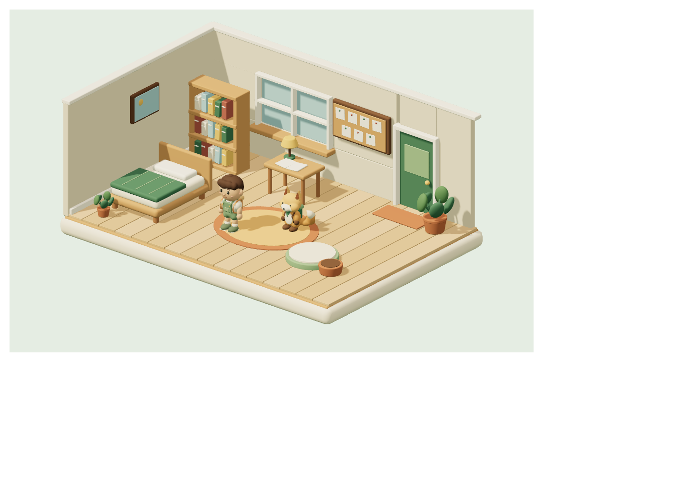
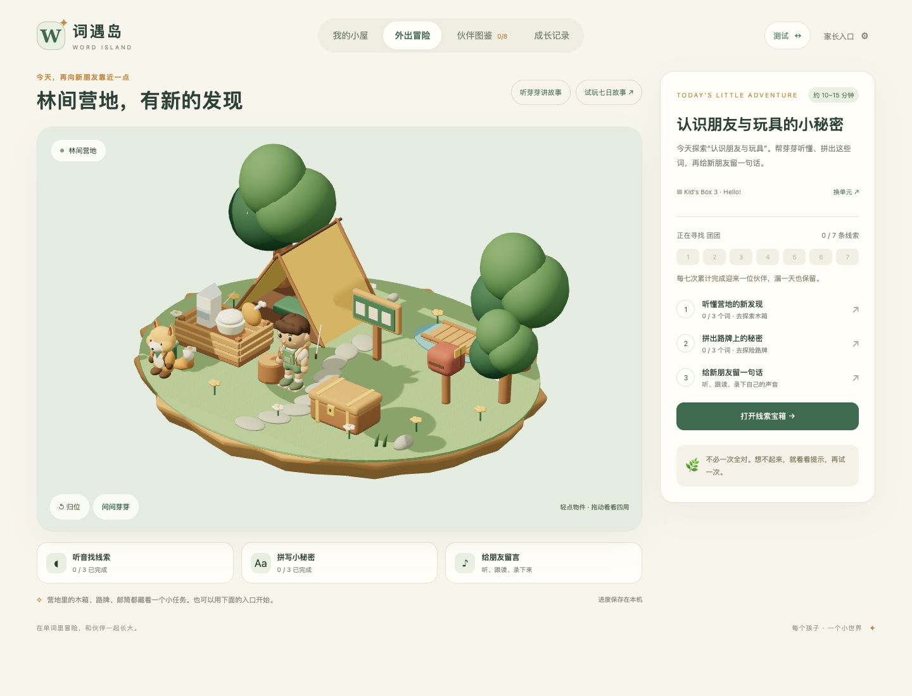
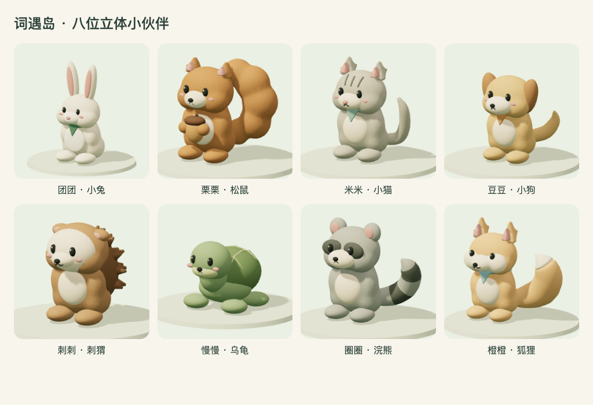

# 词遇岛

给三年级孩子使用的英语学习小世界。同一浏览器最多保存 3 个本地用户，每位孩子每天用约 15 分钟练听辨、拼写与跟读，在固定小屋和可复用的冒险营地之间往返，累计线索，邀请动物伙伴入住。

当前代码版本 **0.7.1** 默认从提供的 **Kid’s Box 3 · Hello!** 开始，书架包含开篇和 8 个主单元；之前的 KB2 Unit 6 仍可选择，旧存档会兼容迁移。每次打开先选择自己的名字，由三维小朋友担任孩子的小岛分身，狐狸向导芽芽用人物气泡介绍小岛，带孩子完成第一轮真实冒险。伙伴图鉴有八位真实三维伙伴，可以先认识灰色形象，再通过学习邀请它们入住。听辨和跟读支持常速、慢读与留白模仿。

0.7 把学习界面与三维代码分开加载，慢网时可以先开始今日任务；手机采用活跃约 30 帧、静置约 12 帧的绘制预算。缓存按内容更新，当前单元音频按需准备，完整离线包由家长主动准备。六项开发任务与验收边界见 [性能任务清单](docs/performance-tasks-2026-11-17.md)，实际统计与检查结果见 [性能验收记录](docs/performance-qa-2026-11-17.md)。

0.7.1 根据微信真机首次下载超时、再次进入可用的反馈，增加一次有界自动恢复，并把整单元音频准备推迟到营地就绪且已进入练习之后。过程与边界见 [首次下载恢复记录](docs/wechat-first-load-fix-2026-11-17.md)。

这是静态网页应用：浏览器打开即可使用，也可在 iPhone / iPad 的 Safari 中添加到主屏幕。Mac 使用同一个网址。Three.js 负责真实三维场景，普通网页负责清晰的学习文字、输入和录音操作；不需要苹果开发者会员。





## 这一版怎么玩

1. 选择自己的名字，或第一次新建名字，然后进入自己的小屋。
2. 在小屋查看今天的任务与伙伴线索，再出发前往营地。
3. 完成一轮听辨、拼写和跟读。默认约 15 分钟，安排少量新内容及需要复习的内容，也保留自主选择入口。
4. 每在 **7 个不同的本地日期** 完成学习，累计本轮 7 份线索，按顺序邀请一位伙伴入住。不是必须连续 7 天；重复当天任务不会重复获得日期线索，漏一天不会扣除累计成果。八位伙伴对应最多 56 个奖励日期，集齐以后仍可继续学习并记录每日完成。
5. 返回小屋查看伙伴与累计进展。首版优先验证孩子是否愿意回来学，以及能否顺利完成一轮学习。

演示模式使用独立存档，可快进 7 格查看团团入住；家长入口的“预览八位伙伴入住”可以直接查看全部伙伴在小屋里的效果。退出演示后回到真实小屋，演示线索与学习进度不能当作真实学习表现。

## 名字与各自的小屋

每次访问或刷新都先选用户，不自动进入上一次的名字。名字只允许中文汉字和英文字母，可中英混用，长度为 1–12 个字；首尾空白会去除，全角字母会规范化，不接受内部空格、数字、标点或表情。英文大小写不同仍算同名。最多保存 3 个用户，没有密码、注册、服务器或云端同步。

每个名字拥有自己的学习记录、教材选择、线索、伙伴、跟读完成状态、引导进度、个人录音和本机恢复备份。小朋友主角显示当前名字；狐狸芽芽继续负责带路。家长入口可以切换或管理名字，录音和麦克风请求期间需先结束当前操作。

删除需要再次确认，会清除该名字在当前浏览器中的全部个人记录、个人录音与浏览器内备份，其他用户以及共用的教材示范音频会保留。已经导出到下载目录的文件由用户自行管理。

这台浏览器如果有旧版未命名存档，第一次起名字时接续原进度、引导和录音，只归属第一个新用户；后建的用户从 KB3 开篇开始。迁移成功后清理旧存储位置，失败时保留旧数据，不创建半完成用户。即使只有旧录音、没有文字进度，也由首次命名接续。

## 世界观与新手故事

狐狸向导芽芽想把小屋变成朋友们的家。词遇岛上有一些害羞的小动物，它们会用英语留下消息；孩子以三维小朋友的身份和芽芽一起听懂、拼写、开口回应，循着每天的新发现认识伙伴。小屋是探险基地，林间营地是寻找消息的地方，教材书架决定这次要读懂哪些词。

每位用户首次进入时，芽芽在三维角色头上显示四段简短气泡，依次说明小屋、英语消息、三个小任务和七条线索。由孩子点按钮继续，不自动跳过，也不自动播放声音。故事之后通过真实学习推进：**门 → 木箱听辨 → 路牌拼写 → 邮筒跟读 → 宝箱 → 带线索回家**。先完成哪一项都可以，提示会照顾当前打开的任务；录音不是通关条件。


点三维芽芽或场景下方的“问问芽芽”，可再看当前任务提示；每位伙伴入住后，点它也有自己的对白。气泡随角色与视角移动，任务快捷入口会标出推荐的下一步。手机先看一句提示，再由“开始”按钮转到题目，避免一进来不知道做什么。

引导可随时跳过，在小屋上方用“听芽芽讲故事”重看。当前开场页、跳过与完成状态保存在该用户的本机引导设置中；刷新并选回名字后能继续，重看不会重置单词、日期线索或伙伴，演示对白也不会完成正式引导。引导设置不属于学习进度备份，换浏览器后会再次欢迎孩子。引导结束后不再每天自动弹出，但仍可主动问路。

## 伙伴图鉴与小屋

第一季的八位伙伴依次是 **团团（小兔子）、栗栗（小松鼠）、米米（小猫）、豆豆（小狗）、刺刺（小刺猬）、慢慢（小乌龟）、圈圈（小浣熊）、橙橙（小狐狸）**。小朋友是主角，芽芽是独立的狐狸向导；狐狸伙伴橙橙使用奶橙色与蓝围巾，保留独立身份。



可编辑 Blender 母版、GLB、动作与多角度检查说明见 [伙伴资产说明](design/companion-assets.md)。

小朋友主角同样提供可编辑 Blender 母版与 GLB，姓名在运行时显示，三个用户复用同一套外观；当前有轻微呼吸、点头与转头待机。模型、实际多角度截图与动作边界见 [小朋友主角说明](design/child-avatar.md)。

伙伴卡片展示实际三维模型截图。点一张卡片，会在共用的一个图鉴预览画布中载入对应 GLB，可拖动绕看；未获得时使用灰色材质，获得后恢复原色。预览和小屋使用同一套模型，不为八张卡片分别创建 WebGL 画布。图鉴用“未相遇、寻找中、已入住”标明状态，当前伙伴显示本轮 0–7 条线索；查看后面的朋友不会跳过当前寻找顺序。

入住的伙伴会保存在该用户的存档中，并在小屋固定位置出现。可以从图鉴回到它身边，也可以直接点三维角色，看它的气泡对白。每个伙伴有自己的七条小发现，完成这一轮后开始寻找下一位；同一用户切换教材和单元仍共用这一份伙伴进度。

## 教材与声音

本轮依据用户提供的 **96 页 KB3 学生用书扫描件**，核对目录、正文与词表，接入 Hello! 和 Unit 1–8 的精选核心词、拼读提示及跟读短句。每个单元可独立选择；这不是整本练习册的数字复刻，也不把全部课文生词都视为必须背写的新词。

单元顺序为 Hello!、Family matters、Home sweet home、A day in the life、In the city、Fit and well、A day in the country、World of animals、Weather report。教材书内页码与 PDF 页码对应关系、词汇选择与未知版次说明见 [教材来源笔记](docs/kb3-source-notes.md)。原 PDF 未复制到仓库或发布资源中。

**选择单元与今日计划：** 首次进入当天任务时固定计划。之后换单元会保留已经开始的任务，新选择用于后续新计划；孩子仍可自由练习新单元的词和短句。新词来自所选单元，到期复习可来自之前学过的单元；声音和拼写各自记录。所有教材共用线索、伙伴与同一个小屋。

自由练习只更新该词的学习统计和复习时间，不会开始或冻结每日计划，也不会代替每日必做答案。拼写答错、请求提示时保留已输入字母；输入法确认候选字不计为提交。完成页会根据尚未完成的任务推荐下一步，全部完成时直接前往宝箱。

**旧进度：** 旧版 v1、v2 学习进度会先按原来的七条线索规则校验，再迁移为 v3。历史每日任务、单词记录、已获得的线索和团团都会保留；v1 当前选择默认转到 KB3 开篇，v2 保留所选单元。旧上限之后已完成、但没有获得线索的历史日期不会回填奖励，新完成的日期继续累计下一位伙伴的线索。首次为旧浏览器存档起名字时，将完整历史写入该用户的 v3 存档。旧备份仍可导入，导入源文件不会被修改，进度备份的外层格式保持兼容。跟读录音按“日期＋短句”分别保存，仍可回听迁入该用户的旧 KB2 日期录音。

请区分两种示范声音：

- **内置合成示范**：用本机已安装的 premium Daniel 声线离线制作全部已接入核心词和补充短句的英国英语示范音。103 个词句目标各有常速、慢读，共 206 段。慢读由同一段发音在本地保留音高、调整为 0.82 倍速度后生成独立文件；两套均加入约 100 毫秒前留白、200 毫秒后留白，并按片段温和调整音量、保留峰值余量。没有裁掉发音、拆碎音节或添加大量逗号来强迫停顿。构建脚本会复用文本、处理参数及校验值未变的文件。音频随网页一起提供，准备离线资源后无需设备安装英语声线。它不是教材录音，来源、处理方法、文本、实测时长与校验值见 `assets/audio/metadata.json`。
- **自己导入的音频**：在家长入口选择已有音频，优先覆盖对应词条的内置声音。例如 `milk.mp3`、`get-up.m4a`（英文空格对应短横线）；KB3 短句使用 `phrase-kb3-hello-1.mp3` 等标识，完整文件与朗读文本可查音频来源清单。单条最多 15 MiB。文件只进入当前浏览器的共用教材音频库，三个用户都可使用，删除某个用户不会删除它，不上传。教材原音仍需实际配套音频；本轮不附带教材音轨。

录音需要允许麦克风权限；音频录制与回放均在本机完成，不上传。自动辨认读出了什么、音素纠错或发音分数不属于本轮已完成能力。没有录音权限时，仍应能继续其他学习任务。

导入示范音频前会先在本机检查是否可解码，坏文件不会替换原有声音；旧版已经导入的坏音频播放失败时，会提示并回退到内置示范。

**朗读练习：** 单词可听常速或慢读，短句还可用“听一句，跟一句”：完整听一次，留出约 3–8 秒自己模仿，再完整听一次后结束。留白根据实际播放时长安排，孩子可以随时暂停；换题、换短句、导航、进入后台或开始录音都会取消旧的等待与重播。听过或等待过不会自动记为已完成跟读。

两种速度都有随程序提供的本地音频文件。自己导入的音频在两种速度和两遍练习中都优先；导入音频的慢读使用浏览器的保留音高慢放。录音或等待麦克风权限时，示范按钮暂时停用，避免示范声混进孩子的录音。音频优化的目标是音量更一致、起止更从容和便于模仿，不把音量处理当作更换声线。

本机对三组样本测试发现，Daniel 在请求 145 与 120 的系统语速参数时导出了相同长度和波形，因此没有把该参数当成实际慢读。本轮采用已安装 FFmpeg 的 Rubber Band 保音高处理，并对成品实际解码检查时长、留白和峰值。没有安装新语音模型、下载声线或调用云端合成；Daniel 本身的音色仍保留。优化前后的三个代表样本与可播放 MP3 对比保存在 `design/audio-comparison/`。

## 数据与离线

- 用户列表与学习进度只存在当前设备、当前浏览器中；每次访问先选名字，不同设备不会自动同步。
- 每个用户独立保存进度、跟读完成状态、故事引导、个人录音和恢复备份；导入的教材示范音频是当前浏览器共用资源。
- 用 **进度 JSON 导出 / 导入** 手动转移或备份当前用户的进度。导入只影响当前用户，导入前的恢复备份也归属该用户。JSON 不包含用户列表、引导设置、教材音频或个人录音；当天尚未领取线索的朗读勾选需要在新设备重新确认。
- 支持同一用户在多个窗口继续学习：进度更新在锁内读取最新存档后写入，朗读标记合并保存；删除与保存共用存储锁，避免迟到操作复活已删除用户。跨标签页互斥使用浏览器 Web Locks，当前真实浏览器验证范围见体验报告。
- 首次访问和版本更新需要联网下载静态程序。安装只缓存学习界面；选好名字后才加载三维世界，首屏只需小屋、主角和向导三份模型，营地与已获得伙伴按需加载。慢网或三维加载失败时，可用“先开始今日任务”练习。
- 当前单元和今日复习词的常速/慢速音频按需准备，不在安装时下载全部 206 段。家长点击“准备离线资源”才会检查并准备完整程序、全部内置音频、场景、八位伙伴和缩略图；显示文件进度，中断后保留已成功文件，重试只补缺失项。首次联网准备成功的部分才能离线打开。
- 模型、音频与发布代码按内容 SHA256 分别缓存，未变化的文件可跨程序版本复用。旧缓存迁移和新内容写入需校验指纹；精简后的模型内容发生变化，首次升级会下载新版。学习进度和录音的存储格式不变，不属于资源缓存清理范围。
- 内置音频已提供，不依赖浏览器合成语音。麦克风授权、触屏与设备性能仍需在实际 iPhone / iPad 上确认。
- 清理浏览器网站数据、卸载主屏幕网页或设备存储清理可能影响本地数据。定期导出进度；导入前先备份当前进度。
- GitHub Pages 仅托管静态文件，无学习业务后端；学习记录与录音不发送到 GitHub。浏览器访问网页本身仍会请求 GitHub 的静态资源。

公开部署后的网页与打包资源可被访问。运行目录不应包含孩子的个人资料、存档、录音、密钥或不适合公开提供的教材资源。本地导入的文件不进入 Git 仓库或部署包。

## 本地运行

预览发布效果时，先安装固定版本的开发工具并构建，再用静态 HTTP 服务打开产物：

```sh
npm ci
npm run build
python3 -m http.server 8765 --bind 127.0.0.1 --directory _site
```

在 Mac 浏览器打开 `http://localhost:8765`。开发时也可以 `npm run dev` 直接运行可编辑源码，源码预览使用原始模型；发布包使用精简模型和分块压缩代码。不要直接双击 `index.html`：ESM、模型加载、麦克风与 Service Worker 依赖合适的网页环境。

代码验证用 `npm test`，其中构建测试需要上述开发工具。esbuild 和 glTF 工具只用于本地或 GitHub Actions 构建，浏览器不会安装它们。修改词表或短句后，在已有 premium Daniel 英音声线与 FFmpeg（含 Rubber Band）的 Mac 上运行 `python3 tools/build_audio.py`，它只补充新增或变化的两速示范并更新离线清单；`python3 tools/build_audio.py --verify` 可实际解码校验现有文件。音频制作不会下载声线或调用云端服务，网站运行不依赖这些制作工具。

伙伴源模型通过既有 Blender / Three.js 流程和 `tools/build_companions.py` 制作。0.7 构建保留原始 GLB、Blender 母版和动画，仅在 `_site` 内生成精简模型；使用高精度量化、去重与保守简化，不引入浏览器端额外解码器。建筑场景保留原始三角形以保持墙面光照。模型或音频变更后，可运行 `npm run manifest` 更新源码预览指纹；`npm run build` 会自动生成发布包清单。

手机测试请使用已部署的 **HTTPS** 链接。Mac 的 `localhost` 只代表 Mac 本机；手机打开 Mac 的普通局域网 HTTP 地址，不能等同于 HTTPS 环境，也不能据此确认录音与离线功能可用。

## 发布到 GitHub Pages

发布地址：[词遇岛](https://feirate.github.io/word-island/)。 手机修复版入口：[直接开始](https://feirate.github.io/word-island/start.html)，与原站同域并共用本地进度。本地修改完成并检查后，提交并推送 `codex/first-playable` 分支，GitHub Actions 会先运行测试，再更新 GitHub Pages。

仓库包含 `.github/workflows/pages.yml`，只在推送 **`codex/first-playable`** 分支或从该分支手动触发工作流时部署，不自动推送或部署默认分支。

1. 在仓库 **Settings → Pages → Build and deployment** 中选择 **GitHub Actions**。
2. 检查 **Settings → Environments → github-pages**。如果环境只允许默认分支部署，加入 `codex/first-playable`，否则分支有工作流也会被阻止。
3. 推送已检查的代码到上述分支，或从该分支运行 **Deploy 词遇岛 to GitHub Pages**。
4. 工作流成功后，从部署环境或 Actions 摘要取得 HTTPS 链接，使用目标 iPhone / iPad 验证。

工作流继续采用 GitHub 官方 Pages actions，执行 `npm ci`、测试和 `npm run build` 后上传 `_site`。产物包含拆分压缩代码、精简 GLB、图标、内容指纹清单和 Service Worker；保留源模块用于兼容检查，但不会在安装时预载它们。不会上传 `.git`、`node_modules`、`tests`、`tools`、`docs` 或 Blender `.blend` 开发源。程序源码属于网页本身，可在浏览器中查看。

如果使用 GitHub Free，Pages 通常要求公开仓库；普通 Pages 网站也不能因仓库私有就被当作私密站点。分发前请检查发布内容。

程序版本需保持 `package.json`、`src/app.js`、`index.html` 和 `sw.js` 一致；发布文件名与资源指纹由构建自动生成。验证新版本后，再断网验证场景、文字、已准备的音频和进度能否正常恢复。仅内容改变的资源需要重新下载，不用人为让整套模型缓存失效。

## 代码与资源

```text
index.html                 网页入口
src/                       学习状态、界面、三维互动与样式
vendor/                    本地 Three.js 及所需加载器
assets/models/             页面运行使用的 GLB 模型
assets/models/companions/  新伙伴 GLB、可编辑源文件与实际三维缩略图
assets/companions-precache.js  伙伴模型及缩略图的生成清单
assets/audio/              合成示范音、来源与自动生成的离线清单
icons/                     主屏幕图标
manifest.webmanifest       主屏幕网页配置
sw.js                      核心与模型离线缓存
tools/                     资产制作或本地检查工具，不部署
docs/roadmap.md            当前边界和后续路线
.github/workflows/pages.yml  Pages 部署
```

模型制作沿用 Blender → GLB → Three.js。Blender 文件和制作脚本保留为开发资产，GLB 才是网页运行模型；点击互动、奖励状态与学习逻辑由网页管理，不包含在单独的 GLB 文件中。

## 验证入口与待孩子体验

本地体验发现、修复和验证记录见 [0.6.2 体验报告](docs/local-qa-2026-11-16.md)。 手机加载修复与受限网络验证见 [0.6.3 手机加载记录](docs/mobile-loading-fix-2026-11-17.md)，持续慢网与缓存写入的后续修复见 [0.6.4 下载记录](docs/model-transfer-fix-2026-11-17.md)。新增 `tools/browser-qa-*.cjs` 覆盖拼写输入、自由练习、倒序学习、双标签保存与删除、损坏音频和小屏幕回家视角。

- `npm test`：学习计划、独立技能记录、奖励幂等、八轮七次非连续日解锁、56 条线索上限、旧版迁移和进度文件边界校验，以及用户姓名/数量限制、进度与录音隔离、删除范围、旧档一次性迁移和存储失败保护。
- `tools/browser-profiles.cjs`：真实页面中的每次访问选人、新建与三人上限、A/B 学习记录及录音隔离、确认删除、共享教材音频保留、刷新与离线重选，以及手机和平板用户入口。
- `tools/browser-check.cjs`：本机 Chrome 中验证真实三维拾取、听辨和拼写重试、测试音源录音与 IndexedDB、进度导出导入、演示与真实存档隔离、离线重载、手机和平板尺寸布局。此检查使用 Playwright，需要开发机可用的该工具和 Chrome；运行时网站没有这个依赖。
- `tools/browser-kb3.cjs` 覆盖九单元选择、各单元音频、短语拼写、同日计划、逐句录音、离线切课和旧版进度/录音兼容；`tools/browser-visibility.cjs` 验证手机离屏和后台停帧、回到画布后恢复。
- `tools/browser-story.cjs` 验证首次故事、刷新继续、首日真实任务直到领取线索、跳过/重看、离线故事、正式/演示引导隔离与手机气泡；`tools/browser-character.cjs` 验证真实角色点击和头顶定位，沿用实际渲染更新，不增加常驻动画循环。
- `tools/browser-speech.cjs` 验证两速真实播放、导入音频优先、两遍跟读与留白、切换和后台取消、麦克风等待及录音保护、离线慢读与手机控件。示范解码保持静音，麦克风只使用测试音源。
- `tools/browser-companions.cjs` 覆盖八位伙伴图鉴、灰色与原色预览、小屋全部入住、角色对白、演示隔离和离线资源；`tools/browser-companion-world.cjs` 检查三维预览与世界中的真实拾取、角色定位和渲染暂停。
- 模型结构检查见 `design/check-assets.cjs`、`design/check-companion-models.cjs`，新伙伴资产信息见 `assets/models/companions/asset-report.json`。实际 Three.js 多角度与动作截图由 `design/render-companions.cjs` 生成，截图与观察记录留在 `design/`；整体验收应结合这些画面，不只看文件能否加载。
- 桌面模拟尺寸和测试音源不等于 iPhone / iPad 真机验收；学习效果、孩子是否愿意持续使用也需要实际试用。第一轮重点反馈：能否找到入口、是否听得清、愿不愿开口、会不会操作，以及最想继续探索哪里。

## 后续方向

先看孩子是否愿意在真实的几天里回来完成任务，再扩充教材和机制。后续战斗模式将把听辨、拼写、跟读转成攻击、防御与角色动态；**学习任务完成才触发胜利**。本轮不开发战斗系统。

具体边界见 [路线说明](docs/roadmap.md)。
