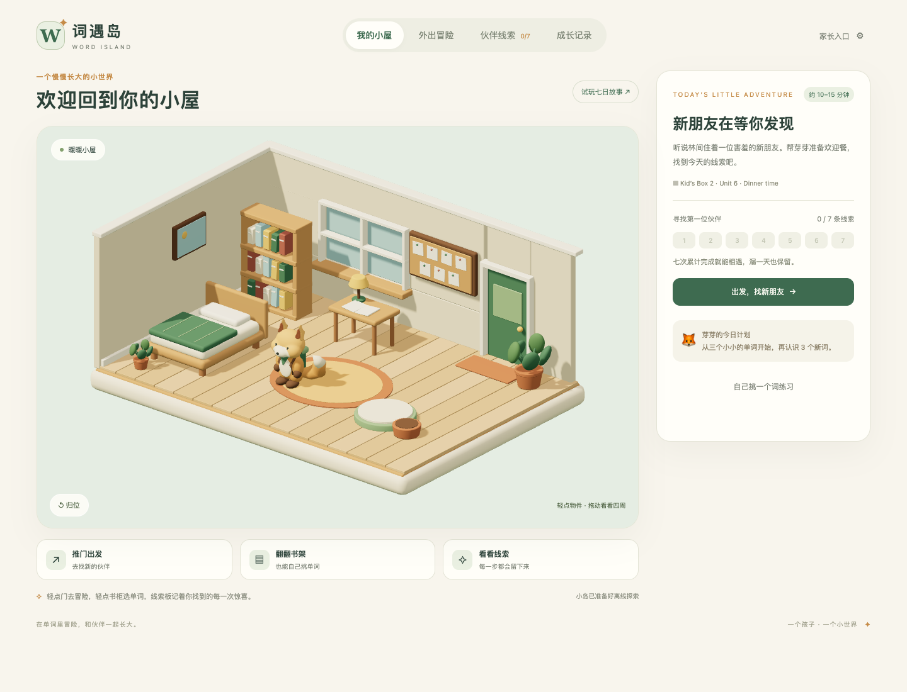

# 词遇岛

给一个三年级孩子使用的英语学习小世界。每天用约 15 分钟练听辨、拼写与跟读，在固定小屋和可复用的冒险营地之间往返，累计线索，邀请动物伙伴入住。

这是静态网页应用：浏览器打开即可使用，也可在 iPhone / iPad 的 Safari 中添加到主屏幕。Mac 使用同一个网址。Three.js 负责真实三维场景，普通网页负责清晰的学习文字、输入和录音操作；不需要苹果开发者会员。




## 这一版怎么玩

1. 在小屋查看今天的任务与伙伴线索，再出发前往营地。
2. 完成一轮听辨、拼写和跟读。默认约 15 分钟，安排少量新内容及需要复习的内容，也保留自主选择入口。
3. 在 **7 个不同的本地日期** 完成学习，累计 7 份线索，邀请伙伴入住。不是必须连续 7 天；重复当天任务不会重复获得日期线索，漏一天不会扣除累计成果。
4. 返回小屋查看伙伴与累计进展。首版优先验证孩子是否愿意回来学，以及能否顺利完成一轮学习。

演示模式使用独立存档，可快进 7 格查看完整的入住过程。演示线索与学习进度不会写入正式存档，也不能当作真实学习表现。

## 教材与声音

首批练习围绕 **Kid's Box 2 Unit 6 的食物与三餐主题**，以用户提供的家庭朗读任务为内容线索，包括食物词、用餐短语和适合本课的拼读练习。教材版本、完整词表和音轨编号仍需结合教材确认；这一版不宣称已经收录整册教材。

请区分两种示范声音：

- **内置合成示范**：用本机已安装的 Daniel 声线离线制作了 10 个单词与 3 条短句的英国英语音频，共约 140 KB。音频随网页一起提供，准备离线资源后无需设备安装英语声线。它不是教材录音，来源、文本、时长与校验值见 `assets/audio/metadata.json`。
- **自己导入的音频**：在家长入口选择已有音频，优先覆盖对应词条的内置声音。例如 `milk.mp3`、`rice.m4a`；短句使用 `phrase-rice-please.mp3`、`phrase-fish-and-chips.mp3`、`phrase-milk-breakfast.mp3`。单条最多 15 MiB。文件只进入当前浏览器音频库，不上传。教材原音仍需实际配套音频；本轮不附带教材音轨。

录音需要允许麦克风权限；音频录制与回放均在本机完成，不上传。自动辨认读出了什么、音素纠错或发音分数不属于本轮已完成能力。没有录音权限时，仍应能继续其他学习任务。

## 数据与离线

- 学习进度只存在当前设备、当前浏览器的本地存储中；不同设备不会自动同步。
- 用 **进度 JSON 导出 / 导入** 手动转移或备份。JSON 是学习进度文件，不等同于教材音频包，也不默认包含全部录音。
- 首次访问和版本更新需要联网下载静态程序。Service Worker 缓存核心程序，模型单独缓存；首次在线准备成功后，已准备好的部分才能离线打开。
- 内置音频已提供，不依赖浏览器合成语音。麦克风授权、触屏与设备性能仍需在实际 iPhone / iPad 上确认。
- 清理浏览器网站数据、卸载主屏幕网页或设备存储清理可能影响本地数据。定期导出进度；导入前先备份当前进度。
- GitHub Pages 仅托管静态文件，无学习业务后端；学习记录与录音不发送到 GitHub。浏览器访问网页本身仍会请求 GitHub 的静态资源。

公开部署后的网页与打包资源可被访问。运行目录不应包含孩子的个人资料、存档、录音、密钥或不适合公开提供的教材资源。本地导入的文件不进入 Git 仓库或部署包。

## 本地运行

不需要 npm 构建；使用一个静态 HTTP 服务即可：

```sh
python3 -m http.server 8765 --bind 127.0.0.1
```

在 Mac 浏览器打开 `http://localhost:8765`。不要直接双击 `index.html`：ESM、模型加载、麦克风与 Service Worker 依赖合适的网页环境。

手机测试请使用已部署的 **HTTPS** 链接。Mac 的 `localhost` 只代表 Mac 本机；手机打开 Mac 的普通局域网 HTTP 地址，不能等同于 HTTPS 环境，也不能据此确认录音与离线功能可用。

## 部署到 GitHub Pages

仓库包含 `.github/workflows/pages.yml`，只在推送 **`codex/first-playable`** 分支或从该分支手动触发工作流时部署，不自动推送或部署默认分支。

1. 在仓库 **Settings → Pages → Build and deployment** 中选择 **GitHub Actions**。
2. 检查 **Settings → Environments → github-pages**。如果环境只允许默认分支部署，加入 `codex/first-playable`，否则分支有工作流也会被阻止。
3. 推送已检查的代码到上述分支，或从该分支运行 **Deploy 词遇岛 to GitHub Pages**。
4. 工作流成功后，从部署环境或 Actions 摘要取得 HTTPS 链接，使用目标 iPhone / iPad 验证。

工作流采用 GitHub 官方 Pages actions，将必要运行文件暂存到 `_site` 后上传：`index.html`、`src/`、`vendor/`、图标、manifest、Service Worker 和运行时资源。不会上传 `.git`、`node_modules`、`tests`、`tools`、`docs` 或 Blender `.blend` 开发源。程序源码属于网页本身，可在浏览器中查看。

如果使用 GitHub Free，Pages 通常要求公开仓库；普通 Pages 网站也不能因仓库私有就被当作私密站点。分发前请检查发布内容。

每次修改已缓存的程序或模型时，更新 `sw.js` 的缓存版本。验证新版本后，再断网验证场景、文字、已准备的音频和进度能否正常恢复；模型更新需要在线重新准备。

## 代码与资源

```text
index.html                 网页入口
src/                       学习状态、界面、三维互动与样式
vendor/                    本地 Three.js 及所需加载器
assets/models/             页面运行使用的 GLB 模型
icons/                     主屏幕图标
manifest.webmanifest       主屏幕网页配置
sw.js                      核心与模型离线缓存
tools/                     资产制作或本地检查工具，不部署
docs/roadmap.md            当前边界和后续路线
.github/workflows/pages.yml  Pages 部署
```

模型制作沿用 Blender → GLB → Three.js。Blender 文件和制作脚本保留为开发资产，GLB 才是网页运行模型；点击互动、奖励状态与学习逻辑由网页管理，不包含在单独的 GLB 文件中。

## 已验证与待孩子体验

- `npm test`：学习计划、独立技能记录、奖励幂等、七次非连续日解锁，以及进度文件边界校验。
- `tools/browser-check.cjs`：本机 Chrome 中验证真实三维拾取、听辨和拼写重试、测试音源录音与 IndexedDB、进度导出导入、演示与真实存档隔离、离线重载、手机和平板尺寸布局。此检查使用 Playwright，需要开发机可用的该工具和 Chrome；运行时网站没有这个依赖。
- 四份 GLB 已做结构验证，两个角色已查看正面、侧面、背面和实际 idle 动作。制作与观察记录见 `design/`。
- 桌面模拟尺寸和测试音源不等于 iPhone / iPad 真机验收；学习效果、孩子是否愿意持续使用也需要实际试用。第一轮重点反馈：能否找到入口、是否听得清、愿不愿开口、会不会操作，以及最想继续探索哪里。

## 后续方向

先看孩子是否愿意在真实的几天里回来完成任务，再扩充教材和机制。后续战斗模式将把听辨、拼写、跟读转成攻击、防御与角色动态；**学习任务完成才触发胜利**。本轮不开发战斗系统。

具体边界见 [路线说明](docs/roadmap.md)。
